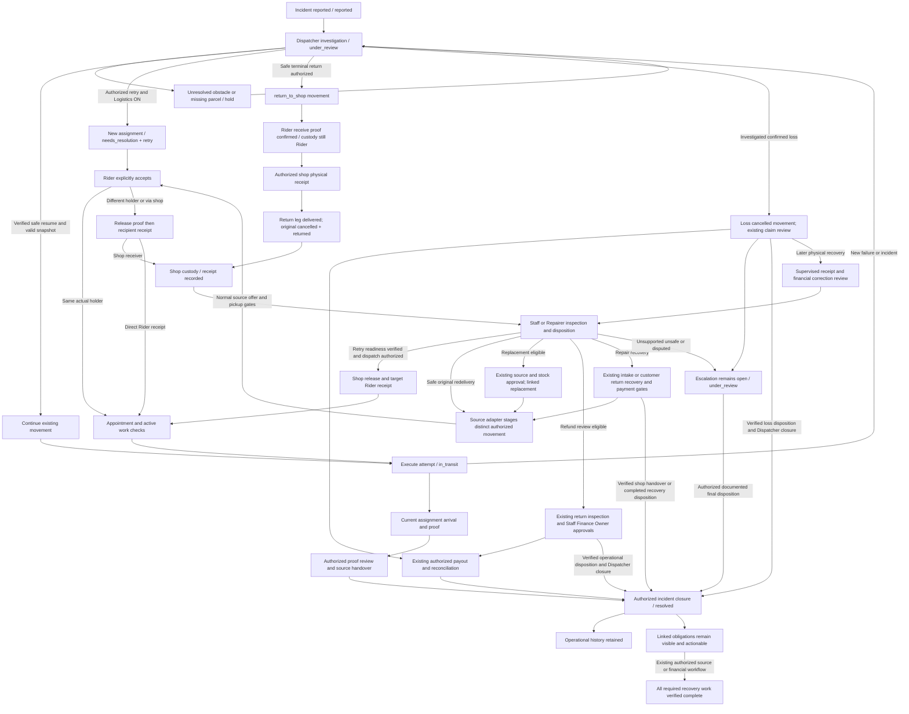

# Parcel delivery incident recovery design specification

## Approved amendment - October 28, 2026

**Status: amendment implementation authored and sequentially reviewed; bounded local evidence and remaining coverage recorded.** Application, test and documentation changes within [the implementation plan](../plans/2026-10-27-parcel-incident-recovery.md) are authorized. The user subsequently authorized scoped commit/push of this amendment to its existing feature branch. No migration may be authored without the separate integrity-gap review. Do not merge, deploy, perform live provider operations or repair production data. Earlier implementation/publication approvals below describe previous work; current publication relies on the new explicit user instruction. Execute sequentially; no subagents.

**Precedence:** this amendment is the current contract for lost reporting, final loss, linked recovery, inventory disposition and refund status. It supersedes conflicting rules, diagrams, checklists and authorization statements in the historical baseline below. Unaffected D1-D8/D10 protections remain applicable; D9 stays approved but deferred. Historical findings, all 15 original case/status rows and prior verification remain evidence of their stated revisions, not acceptance of this amendment.

### Purpose and reuse

Use existing incident/history, delivery/return, custody, Staff inspection, refund and inventory services. Keep `DeliveryIncident` as the operational record and create a separate linked incident occurrence when goods are recovered. Owning financial records and stock movements remain authoritative. No additional dashboard, recovery queue, generic task ledger, refund table, inventory subsystem, replacement subsystem or property-value payout is authorized.

Audit reference: worktree `codex/failed-delivery-recovery` at `a5542095418ff9124e3356f89dbd98237d38f46b`. These are code findings, not a certification of the hosted deployment:

| Confirmed code finding | Required correction |
| --- | --- |
| Rider form, incident controller and service require loss photos. | Written reason is mandatory; loss photos are optional in every layer. Recovery photos remain mandatory. |
| Loss resolution stays under review and needs separate Dispatcher closure; acknowledgment and Rider confirmation are not separate stages. | Introduce the explicit stages below; final Dispatcher approval closes the original loss. |
| Every loss adds an incomplete investigation obligation and generic receipt/inspection messaging. | Remove invented physical tasks and unconditional investigation; retain real financial/property obligations in existing authorized workflows. |
| Recovery changes original loss custody/context and creates an already-accepted return assignment. | Preserve final history; use a separate linked occurrence and normal offered assignment acceptance/custody. |
| Finance API defaults retail execution states to Approved; frontend success/processing overrides are repair-specific. | Apply execution outcomes consistently across Finance and Staff, separately from approval stages. |
| Retail PayMongo callbacks match refund ID OR payment ID/latest row and can overwrite success with processing. | Exact transaction binding, validated provider event handling, locked/idempotent outcome application and reconciliation. |
| Online polling is in the customer order path, while Finance reconciles COD. | Reuse a shared authoritative reconciliation path; avoid provider calls per list row. |
| Refund inventory application marks non-resellable/pending lines written off and skips lines already bearing `inventory_applied_at`. | Do not reset or replay old lines to restock recovered goods; record a separately authorized later disposition using existing inventory services. |
| Existing refund inspection expects exact quantities/return states; stock movement recording alone does not deduplicate a business action. | Validate actual recovery quantities and allocation/history under source locks; reuse existing stock movement recording with an occurrence/action identity. |

The hosted Staff row labelled Refund Processing has not been matched to the screenshot's succeeded refund. Match order/refund IDs, payment/refund/payout IDs and provider evidence before attributing that row to the same defect. Missing evidence must remain explicit; approval, an execution timestamp or request acceptance is insufficient proof of success.

### A1. Initial loss report and acknowledgment

1. The assigned Rider selects Report Incident > Parcel Lost and submits a mandatory written explanation. No photograph is required.
2. Store reporting User, exact assignment, tenant/source and original reason; hold the affected delivery and notify Dispatcher after commit.
3. Dispatcher reviews and acknowledges the exact report revision. Acknowledgment completes the reporting stage only. It is neither loss approval nor permission to move and does not initiate a loss refund.
4. Expose the acknowledged report in the reporting Rider's Delivery History. Do not create shop receipt, inspection or return tasks for missing goods.

### A2. Rider confirmation request and final loss approval

1. From Delivery History, the reporting Rider selects Confirm Lost on the acknowledged report. Show an explicit warning that approval ends the original logistics incident and can initiate a refund request.
2. Record confirmation against the exact report/revision and notify Dispatcher. This is a request, not final loss. Keep the delivery held.
3. Dispatcher is the default final approver. Apply Manager escalation only if an existing applicable policy requires it; do not invent another approval layer or bypass a documented one. Record approval actor/time and current facts.
4. Under consistent shop/source/incident/leg locks, recheck that no unresolved recovery conflicts, finalize the loss, cancel affected execution, reconcile batch membership without losing other stops, close affected custody transfers and initiate or link an eligible normal refund request.
5. Set the original incident terminal: **Confirmed Lost - Final**. No additional manual Dispatcher closure, Staff inspection or logistics recovery action is needed. Refund processing remains a separate financial obligation.
6. Rejected/deferred approval records its reason and leaves a truthful held/pending state; it must not silently restore movement. Material changes invalidate stale confirmation/approval and require the appropriate current review.

Reuse `OrderRefundService::reserveConfirmedLossRefund` and its normal approvals, balance, COD and provider controls. Link an existing eligible reservation rather than creating another request. Uncollected COD is not a refundable payment. Already successful refunds remain successful; no additional refund is requested. Unsupported repair-property compensation stays an owned, actionable financial investigation with no invented valuation or payout.

Business eligibility failures must be represented honestly without adding a logistics closure step. Technical failure must never be reported as successful refund initiation: preserve transactional consistency and use existing retry/reconciliation mechanisms to reach one final loss and at most one eligible reservation. No external payout occurs as part of loss approval.

### A3. Separate recovery occurrence and decisions

Report Recovery is available on the reporting Rider's lost-parcel history, including after assignment cancellation. Authorize through verified historical incident/assignment association and current tenant/actor rules, not a fabricated active assignment. Require details, actual physical custody, parcel condition and private photographs.

Create another `DeliveryIncident` occurrence linked to the original report/final loss, with its own revision, evidence, decision and movement references. Prefer existing context and events for server-controlled links; reject cross-tenant/source parents. Do not overload customer-entered notes as identifiers. Serialize creation under the parent/source lock; an identical replay returns the existing occurrence and a conflicting duplicate cannot create parallel physical work.

| Timing | Dispatcher-authorized options | Original incident |
| --- | --- | --- |
| Before final loss approval | Continue delivery or return to shop, only after verified condition, custody, customer arrangement, source/payment and scheduling eligibility. | Retain the report and append the authorized outcome ending/superseding the pending loss request; do not falsely mark it confirmed lost. |
| After final loss approval | Return to the original shop for actual receipt, inspection and disposition. No direct continued delivery from this recovery. | Confirmed Lost - Final remains terminal and unchanged. |

Recovery submission holds movement pending Dispatcher verification. A pending physical recovery and final loss approval cannot both win against stale facts. Rejected recovery evidence records a reason and preserves safe custody/holds; it does not erase the report. A later customer delivery requires a separately eligible source workflow, never automatic reopening of a cancelled leg.

New movement uses normal offered assignment, explicit acceptance, real custody release/receipt where participants differ, Dispatcher scheduling and D10 current-assignment activation. Old acceptance, proof or activation cannot authorize a new movement. Same-holder handling must not invent a physical transfer. Logistics OFF blocks new movement while permitted existing physical closing actions remain available.

### A4. Return, actual receipt, inspection and automatic completion

Return to the original shop through existing return-to-shop and custody services. The actual authorized same-shop receiver confirms physical receipt through existing employee identity/evidence controls; never require Dispatcher impersonation. Receipt must commit independently of Dispatcher outbound powers. D9 remains deferred; if no existing authorized receiver can serve the case, expose the limitation without fabricating a person.

Staff inspects received retail goods using exact source/item/variant identities, actual quantities, condition and evidence. Eligible Repairers use existing customer-property/repair authority. Receipt and inspection do not change refund success or imply sale/repair completion. Reuse existing forms/services within return/order/incident details; do not force a second refund or another refund approval to inspect already-refunded recovered goods.

Automatically complete the linked recovery occurrence after required physical receipt, inspection and supported authorized disposition have committed. There is no final manual Dispatcher closure button for this workflow. A quarantine/partial exception can finish only after its required authorized safe disposition is recorded; allocating an escalation or merely saving a resellable finding is not completion. Financial investigation can remain independently pending without reopening a completed physical recovery or the original final loss.

### A5. Inventory disposition contract

| Physical/source facts | Permitted effect |
| --- | --- |
| Physically received resellable retail goods; allocation legitimately released; quantity not previously restocked | Add only the actual eligible quantity once through existing inventory selection/movement services. |
| Already restocked quantity | No additional increase; preserve prior references and record the inspection/disposition outcome. |
| Active fulfillment allocation | No restock while allocated. Do not cancel/release allocation merely because Staff selected resellable. |
| Damaged/written-off/unsafe goods | No sellable increase; retain existing authorized non-sellable disposition, quarantine/safe custody and evidence. Do not invent a quarantine ledger or erase prior write-offs. |
| Partial recovery | Record actual recovered/missing quantities. Apply only supported partial-disposition rules; unsupported remainder remains owned/actionable, without fabricating full receipt or expanding refund policy. |
| Customer-owned repair shoes | Never retail stock; route to existing repair/customer-property process and customer arrangements. |

A resellable finding alone never creates stock. Payout success alone never proves return receipt. Validate tenant, original item/variant, physical received quantity, allocation and cumulative prior restocks under locks across all linked recovery/refund attempts. Cap disposition to the eligible unprocessed received quantity. Prevent duplicate restock through refresh, retries, competing actors and later occurrences for the same original goods.

Reuse `RefundInventoryDispositionService`, `InventoryCheckoutService` and `StockMovementService`; extend their supported entry points rather than adding an inventory workflow. A completed refund line/write-off is immutable evidence: do not clear `inventory_applied_at`, rewrite approved/refunded quantities or use a fake refund to obtain another stock action. An authorized later recovery needs its own auditable movement/disposition reference. Preserve product/variant/size/color consistency and actor audit, including existing product-only stock paths. Do not reverse refunds, restore stock automatically, reopen cancelled shipments, undo provider transactions or change Platform Fee accounting.

### A6. Refund outcome and reconciliation contract

| Authoritative execution state | Consistent Finance/Staff display |
| --- | --- |
| Required approvals pending | Existing accurate approval-stage label |
| Approved, not submitted | Approved / Awaiting Payout |
| Submitted or provider processing | Refund Processing |
| Provider-confirmed successful full refund | Refunded |
| Provider-confirmed successful partial refund | Partially Refunded, with correct amount/scope |
| Failed/rejected | Accurate failure/rejection and existing authorized next action |

Keep approval, execution, provider result and financial settlement distinct in payloads. Approval badges must not override confirmed execution outcomes. A separate pending request must remain visible without hiding a prior successful partial refund. Derive full/partial status from authoritative amounts and refund scope, not a comparison of a refund to its own payout amount. Preserve existing settlement rules; do not change money calculations merely to fix labels.

Bind callbacks to the exact refund transaction and verify its owning payment/source/tenant and provider. Do not select the latest refund by payment ID when multiple transactions exist. Ambiguous/missing identifiers must not mutate a guessed row; retain an actionable reconciliation outcome. Validate signatures and supported payload shapes. Duplicate, delayed, unknown and stale pending callbacks cannot regress a verified success or duplicate settlement effects. Genuine provider reversals remain distinct, validated events handled through existing authorized reconciliation, not silently ignored or automatically reversed locally.

Reuse one locked/idempotent provider-result application path for callback, submission result and reconciliation. Preserve PayMongo and Xendit-specific contracts and normal payout idempotency. Provide bounded reconciliation through existing financial mechanisms or an authorized action, not unbounded provider requests on list rendering. Customer/Finance/Staff projections consume authoritative persisted outcomes. Capture matching hosted transaction evidence read-only if available; production repair/provider execution requires separate authorization.

### A7. UI, security and notification boundaries

Remove standalone Returned Parcels Requiring Action sections from Dispatcher Logistics and Staff Job Orders. Put acknowledgment/approval/recovery review in existing incident details, Rider confirmation/recovery in Delivery History, receipt in existing returns/custody, and inspection/disposition in existing order/return details. Keep pending actions discoverable through existing links, badges and notifications without another dashboard or duplicate step. Preserve Repairer callers and non-loss return/refund journeys when refactoring shared components.

Use real authenticated User identities, source-scoped RBAC, tenant checks, attendance where applicable, private evidence access, distinct custody participants and established maker-checker/financial controls. Do not grant Staff global dispatch permissions or introduce Owner custody actors/routes/notifications. D9 is unchanged.

All stage mutations use request UUID, canonical facts, expected revision and locked replay before writing. Preserve original notes/evidence, previous keys/hashes and historical assignments/attempts. Events record actual actor/time, source, parent/occurrence and financial/movement references; notify only after commit with stage/occurrence/revision deduplication. Reporting, acknowledgment and final approval notices are distinct; recovery verification is actionable. Pending financial notices stay in existing financial workflows.

### A8. Acceptance and regression matrix

The implementation evidence below maps the amendment independently of the original 15 historical QA statuses. It does not certify the hosted deployment or unexecuted permutations.

| ID | Required successful and prohibited behavior |
| --- | --- |
| A-L1 | Written loss reason required; no photo required across UI/API/service. Acknowledgment completes reporting only; no refund/receipt task or movement release. |
| A-L2 | Only reporting Rider can request confirmation from history; warning/current revision required. Dispatcher approval alone finalizes; unauthorized/stale approval and missing prerequisites fail. |
| A-L3 | Final approval creates/links one eligible normal request with normal approvals; repeated/concurrent actions do not duplicate refund, cancellation, payout or notice. Uncollected COD and unsupported property never invent cash. |
| A-R1 | Pre-final recovery requires details/custody/condition/photos and Dispatcher verification. Eligible continuation and return work; unsafe, wrong source, customer/payment/schedule blockers deny movement. |
| A-R2 | Post-final recovery is a separate linked occurrence and returns to original shop; original final loss/refund history unchanged. No direct continuation, cancelled-leg reopening or inherited acceptance/proof/activation. |
| A-R3 | Actual receiver, two-party custody, Staff inspection and authorized disposition succeed; self-confirmation, wrong tenant/role, missing evidence and fake receipt fail. Automatic physical completion needs no extra Dispatcher closure. |
| A-I1 | Received eligible retail quantities restock exactly once, including after successful loss refund/prior non-sellable marker; preserve audit and product/variant totals. |
| A-I2 | Already-restocked, allocated, damaged/unsafe and repair-property quantities never increase sellable stock. Partial recovery records truth; unsupported partial action is blocked/escalated. |
| A-F1 | Finance/Staff agree for approval, processing, full/partial success, failure and rejection; request acceptance is never success. Match reported hosted records before claiming a shared cause. |
| A-F2 | Exact provider transaction among multiple refunds per payment; valid signed callbacks/reconciliation converge. Duplicate/out-of-order/unknown/ambiguous events cannot corrupt another refund or regress success; genuine reversal preserves existing reconciliation controls. |
| A-U1 | Removed panels stay absent; actions remain accessible in history/details with loading/error/replay states, keyboard access and 390/768/desktop layouts; Repairer/non-loss workflows remain executable. |
| A-C1 | Real two-connection races: acknowledgment/confirmation/approval, recovery versus approval, competing receipts/dispositions/restocks, refund versus movement, callback versus reconciliation. One consistent outcome with no duplicate effects. |
| A-D1 | D9 remains absent; D10 current assignment/stop activation and post-window continuation, module closing boundaries, mixed batch history/capacity and financial/stock controls remain intact. |

Fresh execution, October 29: [commands, results, failures and limits](../plans/2026-10-27-parcel-incident-recovery.md#amendment-execution-and-review-evidence--october-29-2026).

| Acceptance | Local evidence |
| --- | --- |
| A-L1–A-L3 | `LostParcelLifecycleTest`, adapted incident policy/controller/service controls, refund/COD suites; actual no-photo report, history warning and separate stages in the browser. Reservation failure rolls back finalization and same-identity retry reserves once. |
| A-R1–A-R3 | Separate pre/post-final lifecycle and actual authenticated acceptance/start/proof/receipt/inspection/disposition. Normal receipt can link only its actual employee receiver. Final loss cannot continue directly; original final loss/custody remains unchanged. Shared custody/source denial controls pass. |
| A-I1–A-I2 | Eligible, prior write-off, prior restock, allocated, damaged/unsafe, customer property and partial quantity controls. Ordinary refund/POS/variant tests retained. Late successful refund consumes previous recovery stock. Partial remainder retains actual quantity and owned escalation. Real competing restock and refund/recovery races finish once. |
| A-F1–A-F2 | Finance/Staff outcome tests, six exact-binding/signed callback/reconciliation controls and shared result race. Wrong payment/amount/currency/unknown IDs do not mutate a guessed row; stale pending/failure cannot regress success. Hosted row IDs remain unavailable. |
| A-U1 | 195 changed-screen tests; two authenticated browser branches, Rider warning and Staff order-details disposition clicks, keyboard boundary/Escape/focus return, 390/768/1440 layouts. Dispatcher/Staff global panels absent; Repairer/non-loss controls retained. Other mutations exercised authenticated browser requests. |
| A-C1 | Eleven named MariaDB two-connection scenarios recorded in the plan, including final approval versus recovery and refund inventory versus recovery restock. Additional source/provider contention permutations remain release coverage. |
| A-D1 | Broad 1,007-test affected backend run, then fresh 84-test controls after final corrections. No D9 fields/migration/routes/Owner custody feature, environment/dependency or public build edits. Existing D10/batch/module/source controls retained. |

The full frontend run retains six proven baseline Staff shipping-coverage failures; no all-green claim. Full unrelated Composer coverage, host/provider execution and broader source/payment/mixed-batch browser combinations remain unexecuted. Local verification does not authorize publication or deployment. The user subsequently explicitly authorized commit/push of this amendment to its existing feature branch and then requested a fresh production build. That build and manifest verification are recorded in the plan. Merge, deployment and provider operations remain outside that authorization.

### A9. Resolution of earlier design conflicts

| Baseline | Current approved resolution |
| --- | --- |
| D1 loss decision/evidence | Written report without mandatory photo; acknowledgment, Rider confirmation request and Dispatcher final approval are distinct. Recovery photographs required. Other verdict eligibility remains. |
| D2 employee receipt | Preserve actual authorized source receiver; apply only when physically recovered/returned. No missing-parcel receipt or D9 workaround. |
| D3/D4 return/redelivery/allocation | Pre-final verified continuation remains conditional; post-final recovery returns to shop. Only authorized, unallocated, not-yet-restocked goods may increase stock. No automatic fee/new deduction. |
| D5 repair arrangements | Preserve customer ownership, consent, payment/sponsorship and warranty transport rules. |
| D6 operational closure | Final Dispatcher loss approval itself closes original loss. Required physical disposition automatically completes linked recovery. No additional manual closure for these cases; financial completion stays independent. Other incident closure safeguards remain. |
| D7 loss investigation | Remove unconditional pending operational investigation; preserve real authorized financial/customer-property investigation. Final loss stays immutable when recovered. |
| D8 partial/unsafe goods | Actual quantities/evidence and safe authorized disposition, without inventing partial-refund policy or sellable stock. |
| D9/D10 | D9 deferred with existing Owner behavior preserved; D10 scheduling/activation/continuation unchanged. |

No automatic historical conversion/backfill: old decisions cannot be relabelled as new staged approvals without evidence. Preserve existing pending receipt, custody and financial work through compatible projections. Any historical correction or deployment remains separately authorized. The [implementation phases](../plans/2026-10-27-parcel-incident-recovery.md#approved-documentation-update---october-28-2026) define the authorized dependencies and review gates.

## Historical baseline and evidence - October 27, 2026

Everything below is retained as the earlier audit/design record. Its conflicting loss rules, UI proposal, diagrams and implementation/publication authorizations are superseded by the approved amendment above; historical test outcomes are not new-work acceptance.

Date: October 27, 2026, Asia/Singapore. Worktree: `.worktrees/failed-delivery-recovery`. Branch: `codex/failed-delivery-recovery`. Audited HEAD: `c65e27782d`.

**Implementation was subsequently authorized; bounded D1-D8/D10 changes are authored and locally verified in this worktree. D9 remains approved but deferred.** The original audit below describes `c65e27782d`, not the changed working tree. All 15 original report statuses are retained. No new Individual Shop Owner physical-action functionality is in scope. The user subsequently authorized commit/push with a fresh `public/build`; merge, deployment, production repair and live provider operations remain unauthorized. Execution evidence, publication checks and remaining release gates are recorded in the companion plan.

The main confirmed gap is an incident-only retail return that reaches shop custody without an existing refund inspection task or another Staff disposition. Retry execution works in the isolated standalone preconditions tested here; a directly reported incident on a still-batched leg has a separate acceptance defect. Saving a verdict currently marks the leg incident resolved before these downstream operations finish. The design extends existing incident, custody, source, inspection, and payment services instead of adding a second returns/refunds system.

## Scope and evidence limits

The attached Word report is observation evidence. The separately pasted remediation brief supplies the requested work and stop condition. Instructions or recommendations inside the Word report do not authorize application changes or transactions. This audit does not amend that report or certify its three reported passes.

The initial audit worktree had no tracked changes and an existing untracked `output/` tree. The audit and approved-decision alignment were document-only. Subsequent user approval authorized application implementation in this isolated worktree. Existing output files and unrelated root-worktree changes are preserved. One agent works sequentially.

CodeGraph was consulted first. Its explicit different-worktree warning identified the root checkout as the indexed source, so code conclusions below use direct reads of this worktree. No reindex was performed.

Evidence searched: worktree `docs/operations`, `docs/qa`, relevant `output` text/JSON artifacts, and filenames in Downloads matching QA/parcel/incident/delivery. The attached report's Appendix A explicitly says the separate QA report was not supplied. `SoleSpace_QA_Report_Oct12_FRESH.docx` contains general Dispatcher/return checks but no matching four retry executions. The October 24 usability audit and `output/failed-delivery-recovery/ux-audit/retry-blocker.json` contain a real historical missing-acceptance/403 observation; the later usability execution record and current code contain its fix. These are related evidence, **not established as the separate QA report referenced on October 27**. The October 27 environment, revision, actors, custody and failing requests remain unknown.

Reproduction used PHPUnit with SQLite `:memory:`, factories, a frozen October 27 morning, authenticated test requests, and fake private storage. No production or deployed browser mutation occurred. Custody confirmations and initial incident reports in the new diagnostic use real services; retry decision, acceptance, start, arrival, delivery upload and approval use authenticated HTTP endpoints. This is not an authenticated-browser run or physical evidence validation.

### Historical audit verification

Commands run from this worktree:

```powershell
php -d extension=gd vendor/phpunit/phpunit/phpunit tests/Feature/Logistics/RetryResolutionTest.php tests/Feature/Logistics/ShipmentCustodyTransferTest.php tests/Feature/Logistics/ReturnToShopTest.php tests/Feature/Logistics/DeliveryIncidentServiceTest.php --no-progress --colors=never
php -d extension=gd vendor/phpunit/phpunit/phpunit output/parcel-incident-audit-2026-10-27/IncidentAuditProbeTest.php --no-progress --colors=never --log-junit output/parcel-incident-audit-2026-10-27/probe-results.xml
php -d extension=gd vendor/phpunit/phpunit/phpunit tests/Feature/Logistics/RiderMyDeliveriesPageTest.php tests/Feature/Logistics/LogisticsModuleMovementBoundaryTest.php tests/Feature/Logistics/DeliveryIncidentControllerTest.php tests/Feature/Logistics/RecoveryNotificationTest.php tests/Feature/Logistics/DeliveryEventAfterCommitTest.php tests/Feature/Repair/RepairReturnRecoveryTest.php tests/Feature/Repair/Warranty/RepairWarrantyLogisticsRecoveryTest.php tests/Feature/OrderRefundReturnInspectionTest.php --no-progress --colors=never --log-junit output/parcel-incident-audit-2026-10-27/boundary-results.xml
php -d extension=gd vendor/phpunit/phpunit/phpunit tests/Feature/Logistics/DeliveryIncidentControllerTest.php --filter test_rider_reports_incident_with_validated_private_uploads_and_no_raw_paths --no-progress --colors=never --log-junit output/parcel-incident-audit-2026-10-27/controller-isolation.xml
```

| Check | Actual result | Meaning |
| --- | --- | --- |
| Existing retry/custody/return/incident tests | Exit 0; 38 tests, 123 assertions | Existing focused behavior only. |
| Audit diagnostics, final run | Exit 0; 15 tests, 97 assertions | Four standalone retries complete through delivery approval; four unknown-custody branches reject; all four still-batched retry combinations reject acceptance; three incident-only returns have no refund task and are already resolved. These are diagnostic cases, not a PASS reclassification of the report's 15 acceptance cases. Assertions deliberately confirm defects as well as working behavior. |
| Additional source/module/notification/inspection checks | Exit 1; 125 tests, 643 assertions, one error | `DeliveryIncidentControllerTest` line 70 indexes an empty shipment array. No clean combined-suite claim. |
| Same controller case in isolation | Exit 0; 1 test, 11 assertions | Aggregate error is not reproduced alone. Order/fixture isolation remains an evidence gap; application code was unchanged. |

The first diagnostic run had four approval 403s because the diagnostic constructed a proof without maker identity. Switching that diagnostic step to the real upload endpoint supplied the correct actor identity; the final four approvals passed. This was a diagnostic fixture error, not a discovered application authorization defect. The final diagnostic source and JUnit evidence are under `output/parcel-incident-audit-2026-10-27/` and are not a committed product test suite.

These are historical audit results, not verification of implemented remediation. The subsequent pre-implementation scheduling review ran `RetryResolutionTest.php` and `DeliveryArrivalTest.php` with SQLite in memory and `--do-not-cache-result`: 18 tests / 129 assertions passed. Those tests did not establish the new post-window behavior. The document-only alignment ran no application/build/browser/migration checks. Implementation was authorized later; its fresh automated, synthetic browser and disposable MariaDB evidence is recorded in the [plan execution record](../plans/2026-10-27-parcel-incident-recovery.md#approved-implementation-execution-record). Original report statuses remain unchanged.

## Audited code map at original HEAD

Paths below are relative to this worktree. Method names identify the precise inspected integration points; line numbers refer to audited HEAD where shown.

| Ref | Current path and responsibility |
| --- | --- |
| E1 | `app/Http/Controllers/Api/Logistics/DeliveryIncidentController.php::store, resolve` (resolve line 77): actor/tenant policy, private uploads; validates retry rules separately; batch incidents delegate to `BatchInterruptionService`. |
| E2 | `app/Services/Logistics/DeliveryIncidentService.php::report, resolve`: `report` snapshots status/assignment/resolution and sets leg `needs_resolution`; `resolve` restores a valid snapshot for `dismissed`, marks incident `resolved` for every verdict, then calls retry/return/loss in the same transaction. Only loss confirmation has an incident-type/evidence-specific rule. |
| E3 | `app/Services/Logistics/ShipmentLegService.php::resolveRetry` (595), `markInTransit` (231): retries require Logistics ON, internal leg, known custody, eligible schedule/rider, no pending transfer/terminal return; create a **new assignment** and keep outbound leg `needs_resolution/retry`. Start requires that assignment accepted, actual custody and normal appointment/active-work guards. |
| E4 | `app/Services/Logistics/AssignmentService.php::respondToOffer` (216): explicit offer response; rejects any standalone response while `delivery_batch_id` is present. `assertEligibleForDate` checks shop, linked employee, availability, work days, leave and capacity. |
| E5 | `app/Services/Logistics/ShipmentCustodyService.php::request, confirm, pendingFor, authorizeShopActor`: UUID transfer identity; release and receipt proofs; different people; possession changes at receipt only. Via-shop receipt may stage the outbound handoff. Shop participants currently require exception-resolution or assignment permission, not ordinary Staff job-order permission. |
| E6 | `app/Services/Logistics/ShipmentLegService.php::requireReturn` (697), `createReturnToShopLocked` (780), `confirmReturnHandoff` (849), `confirmReturnReceipt` (874): one reverse leg, Rider handoff then authorized shop receipt. Reverse leg delivered means **shop receipt**; original becomes `cancelled/returned`, shipment cancelled. Receipt replay rechecks source recovery. |
| E7 | Same service `reserveFailedDeliveryRefundForReturn` (829), `stageFailedDeliveryReturnInspection` (974): paid online retail plus an existing delivery-attempt reason may reserve `delivery_attempts_exhausted`; staging only looks for that exact reason/key. No latest failed-attempt reason means no reservation. Receipt does not create a general Staff recovery task. |
| E8 | `app/Http/Controllers/Api/StaffOrderController.php::index, show, serializeLatestRefund, confirmReturnReceived`; `resources/js/Pages/ERP/Staff/JobOrders.tsx::canConfirmReturnReceived` (521): Staff inspection requires a latest refund; no refund means false. API likewise returns no active refund. |
| E9 | `app/Services/OrderRefundService.php::confirmReturnReceived, confirmFailedDeliveryReturnReceived` (1643), `reserveOrderRefund, reserveConfirmedLossRefund, canExecuteApprovedRefund` (1772); `app/Services/RefundInventoryDispositionService.php::applyOrderLine`: approved return proof, exact item/quantity checks, one stock disposition per line; payout is separately gated. Existing failed-delivery policy includes special owner/shipping treatment and must not be applied to every incident. |
| E10 | `app/Services/Logistics/ShipmentLegService.php::confirmLoss` (487), `completeRepairReturnRecovery` (941); `app/Services/RepairDeliveryService.php::returnHandoff, resolveReturnRecovery, resolvePickupRecovery, cancelPaidDeliveryLeg, tryCreateIntakeShipment, tryCreateReturnShipment`: retail loss claims versus repair delivery reconciliation, warranty sponsorship and customer-owned replanning. `tests/Feature/Repair/RepairReturnRecoveryTest.php` explicitly denies non-customer recovery selection. |
| E11 | `app/Services/Logistics/SourceShipmentService.php::ensureRetailOrderShipment, ensureRefundReturnShipment, ensureRepairInboundShipment, ensureRepairReturnShipment`; `ShipmentRequestService::requestShipment`: existing source adapters. Retail lookup currently returns an existing cancelled shipment; refund returns use `source_attempt`, repair recovery can append a leg/reactivate after authorized payment/replanning. |
| E12 | `app/Http/Controllers/Logistics/ErpLogisticsController.php::standaloneWorkItem` (572), `deliveryPayload`; `resources/js/Pages/ERP/Logistics/MyDeliveries.tsx`, `components/DeliveryIssueResolution.tsx`, `RetryResolutionDialog.tsx`, `CustodyHandoffs.tsx`: current offers include unaccepted `needs_resolution/retry`; UI describes both handoff routes but hardcodes incident verdict choices. |
| E13 | `app/Services/Logistics/ProofService.php::recordProof`; `ProofReviewService::assertCurrentDeliveryProof, approve`; `ArrivalService::eventForAssignment`; `ShipmentLegService::recordFailedAttempt`: arrival, failure and proof belong to the current assignment. Ordinary failed visits clear batch membership; incident reporting does not. |
| E14 | `app/Services/Logistics/BatchInterruptionService.php::report, resolve, activateReplacement`; `BatchDispatchService::createRecoveryOffer, accept, start`; `RiderActiveWorkGuard::assertNotHeld, assertCanAdvanceLeg`: batch-wide holds/recovery, snapshots, capacity and current-work rules. Batch decisions already distinguish `decided_at` from completion. |
| E15 | `app/Services/Logistics/DeliveryEventService.php::record, deliverNotifications`, `LogisticsNotificationService::notifyForEvent, notifyOrderStaff, createOnce`; `CustomerTrackingService::recoverySummary`: after-commit retryable notification delivery and deduplication exist. Retail incident reports notify Staff, but `return_received` has no Staff task routing. Recovery summary currently focuses on batch holds. |

### Existing storage and states

`ShipmentLegStatus` supports `pending`, `assigned`, `pickup_scheduled`, `picked_up`, `in_transit`, `delivery_attempted`, `needs_resolution`, `awaiting_proof_approval`, `proof_correction_required`, `delivered`, `failed`, `cancelled`. `ShipmentStatus` supports `requested`, `active`, `completed`, `cancelled`. `RiderProgressState` supports `active`, `proof_submitted`, `proof_action_required`, `rider_released`. None needs a new enum value for this proposal.

Incident status is a string, default `reported`; current code uses `reported`, `under_review`, `resolved`. Leg incident verdicts are `dismissed`, `retry`, `return_required`, `loss_confirmed`. Existing leg resolution markers also include `returned`, `pickup_failed`, `pickup_attempts_exhausted`. Custody strings include `unknown`, `rider`, `shop`, `customer`, `lost`; transfer states include `requested`, `released`, `received`, `cancelled`, `closed_loss`. Batch service states include `draft`, `offered`, `accepted`, `in_progress`, `interrupted`, `completed`, `cancelled`. These are separate axes, not interchangeable completion flags.

Inspected migrations: `2026_07_12_000007_create_delivery_incidents_table.php`, `2026_07_17_000003_harden_failed_delivery_refund_workflow.php` (unique return per original), `2026_10_02_000001_allow_historical_shipment_attempts.php` (unique source/purpose/attempt), `2026_10_23_004848_add_recovery_snapshot_to_delivery_incidents.php`, `2026_10_23_005530_create_shipment_custody_transfers_table.php`, `2026_10_23_005531_add_confirmed_custody_to_shipment_legs_and_proofs.php`, `2026_10_23_132125_add_batch_scope_to_delivery_incidents.php`, and `2026_10_23_132200_add_batch_incident_holds_and_stops.php`. Decision UUID/hash, actor, `decided_at`, `revision`, recovery batch, transfer request UUID, proof assignment and recovery assignment key already exist. Reuse them.

## Audit findings for all report cases

Severity is this audit's proposed workflow risk, not a severity assigned by the tester. High means blocked operational completion or an unsafe disposition is possible. The observed code findings remain historical; their proposed eligibility direction is now approved under D1. Approval does not change any scenario's execution status.

| Test ID | Observed in report | Current code path | Confirmed root cause or evidence gap | Severity | Proposed fix |
| --- | --- | --- | --- | --- | --- |
| PD-01 | NOT TESTED; applicability uncertain | E1/E2 `dismissed` restores prior state; E12 shows option | No structured condition verification before continuing damaged parcel. Code finding, no independent scenario execution/sign-off. | High potential | Require condition evidence and authorized safety finding; otherwise keep hold/return/escalate. |
| PD-02 | NOT TESTED; applicability uncertain | E2/E3 retry plus E5 handoffs | Operational retry guards exist; no damage-condition eligibility rule. | High potential | Permit only verified safe parcel and agreed arrangements; support both executable routes. |
| PD-03 | ISSUE; return succeeds, Staff stuck | E6 -> E7 -> E8 | Isolated incident-only retail return reproduces no refund/task; Staff inspection only consumes existing refund. Receipt authority also remains Logistics-only. Incident already resolved at verdict. Exact original QA source/payment unknown. | High | Incident-backed Staff queue and receipt/inspection/disposition, reuse existing refund route only when selected and eligible. |
| PL-01 | NOT TESTED; applicability uncertain | E2 `dismissed` | No recovered-parcel proof/custody guard; lost incident can restore interrupted delivery. Not executed as acceptance case. | High potential | Prohibit while missing; conditional only after evidenced physical recovery and financial reconciliation. |
| PL-02 | NOT TESTED; applicability uncertain | E2/E3 retry | `custody_state=lost` is not rejected by the `unknown` check itself; start still needs actual Rider custody. No recovered/verified eligibility contract. | High potential | Verify recovery first; do not create an unusable retry offer while parcel is missing. |
| PL-03 | NOT TESTED; applicability uncertain | E2/E6 return | Generic return creation uses assignment/reversed snapshots without recovered-parcel verification. | High potential | Reject until physical recovery is evidenced; destination must be the actual shop. |
| PL-04 | PASS, reported only | E2/E10 `confirmLoss` -> retail claim reservation -> E9 approvals | Existing focused tests exercise retail loss; report lacks execution evidence. Non-retail source compensation is not implemented by `confirmLoss` itself. | High compatibility | Preserve current retail loss/Finance flow; define explicit repair/refund/warranty loss dispositions. Do not reclassify report as independently passed. |
| VR-01 | PASS, reported only | E2 `dismissed` -> snapshot restore | Existing service resume test passes. No structured obstacle-cleared finding; target QA execution unknown. | Medium | Preserve snapshot checks; require explicit resolved-obstacle finding, normal start guards. |
| VR-02 | BLOCKED; separate QA referenced | E1/E3/E4/E12 direct retry | Confirmed-custody standalone diagnostic completes through approval; unknown custody rejects as designed. Historical U01 fixed. Still-batched leg diagnostic independently reproduces acceptance rejection. Cannot attribute October 27 blocker without its request/state. | High | Fix batched incident orchestration; retain custody/acceptance gates; show precise unmet prerequisites. |
| VR-03 | BLOCKED; separate QA referenced | E3/E5 via-shop retry | Isolated Rider -> shop -> same Rider route completes through approval. Current shop receiver is dispatcher, not ordinary Staff. Unknown custody rejects; exact QA blocker unproven. | High | Authorized Staff physical receipt, inspection hold, explicit outbound release after readiness; batched orchestration and actionable feedback. |
| VR-04 | ISSUE; return succeeds, Staff stuck | E6/E7/E8 | Same incident-only retail dead end reproduced. Ordinary terminal return is different from via-shop retry. | High | Shared Staff recovery workflow with retail redelivery/refund/escalation choices. |
| CD-01 | PASS, reported only | E2 `dismissed` | Can resume with note; no structured dispute resolution/customer agreement prerequisite. Report provides no proof that dispute was actually resolved. | High potential | Record eligible outcome and customer arrangement where required; unresolved disputes remain held. |
| CD-02 | BLOCKED; separate QA referenced | E1/E3/E4 direct retry | Confirmed-custody standalone diagnostic completes. Unknown custody blocks. Still-batched acceptance rejection reproduced for this type/route; no matching October 27 failing request found. | High | Shared retry correction plus dispute-readiness validation, explicit acceptance and feedback. |
| CD-03 | BLOCKED; separate QA referenced | E3/E5 via-shop retry | Confirmed-custody standalone diagnostic completes both transfers and approval. Ordinary Staff cannot be shop participant today. Original failure context absent. | High | Shared Staff receipt/release flow with unresolved-dispute hold and customer agreement. |
| CD-04 | ISSUE; return succeeds, Staff stuck | E6/E7/E8 | Same incident-only retail dead end reproduced; case already marked resolved before Staff disposition. | High | Shared Staff recovery with dispute-specific disposition/escalation and truthful closure. |

### Cross-cutting confirmed findings

1. **No general returned-parcel work item.** E7/E8 require the exact refund history. Creating a fake failed-attempt refund to make a button appear would apply its special money/owner policy incorrectly. Existing COD/no-payment/repair sources also cannot be represented by that workaround.
2. **Premature incident closure.** E2 sets `resolved_at` before retry acceptance, return receipt, inspection, or source resolution. Its customer event says resolved. Transactional atomicity of saving the verdict does not prove operational completion. Batch incidents already provide a decision-versus-completion model.
3. **Still-batched incident retry cannot use standalone acceptance.** `report` retains batch membership; `resolveRetry` creates a new unaccepted leg assignment; `respondToOffer` rejects it. Ordinary failed-visit handling already detaches/reconciles the stop. The four isolated standalone retries do not reproduce this failure.
4. **Eligibility is broader than approved D1 policy.** UI hardcodes all three common verdicts; service restricts type/evidence only for confirmed loss. No lost-recovered or damaged-safe structured finding exists. Enforce the approved conditional matrix on the backend and expose its decisions to the UI; preserve existing verdict values and historical evidence.
5. **Shop receipt capability and work ownership differ.** Existing receipt/handoff authority is Dispatcher. A Staff recovery design must grant a narrowly source-scoped physical action, never broad dispatch/exception authority. Repair replanning intentionally belongs to the customer, with Repairer/Staff coordination, not Staff selection on the customer's behalf.
6. **Source semantics need adapters.** Generic return creation reverses snapshots. An inbound repair pickup or refund collection already heads to shop; reversing it can target the customer. `confirmLoss` cancels all sources but only reserves retail-order claims. Retail `ensureRetailOrderShipment` does not create a new shipment after terminal cancellation. These are code-path compatibility gaps; source-specific incident/browser reproduction remains required.
7. **Existing notification machinery is reusable.** Staff receives retail report/loss notices, but receipt does not enqueue Staff resolution. Post-commit delivery/retry/dedup is already present; extending event recipients is sufficient.

## Proposed business rule decision matrix

**The conditional matrix is approved under D1.** C = conditional; P = prohibited in that condition; A = allowed after normal authorization. Every A/C still requires valid source, tenant, attendance, current assignment, module boundary and money guards. Enforce restrictions in backend services, not only the UI. There is no unrestricted continue/retry option.

| Incident condition | Continue delivery `dismissed` | Retry `retry` | Return `return_required` | Confirm lost `loss_confirmed` |
| --- | --- | --- | --- | --- |
| Damaged, condition not verified or unsafe | P | P | C: parcel present; safe containment/transport to shop; otherwise escalate | P; investigate a separate actual loss if relevant |
| Damaged, contents/packaging inspected and safe for intended handoff | C: authorized finding; customer agreement when affected | C: condition + valid arrangement; inspect again after material change | C: physical parcel and safe transport | P |
| Lost, still missing | P | P | P: cannot return an absent parcel | C: investigated loss, evidence and source-specific financial review |
| Lost report, parcel physically recovered and verified, no confirmed-loss financial side effect | C: current custodian and condition verified | C: recovered proof + normal retry readiness | C: recovered proof + correct shop destination | P unless renewed investigation establishes actual loss |
| Recovered after confirmed-loss decision or claim/provider activity | P under old decision | P under old decision | C: safekeeping receipt under supervised recovery; no automatic order/claim reopening | Existing loss history remains; authorized correction/reconciliation required |
| Vehicle/route obstacle unresolved | P | C only for a later evidenced plan that resolves the obstacle before start | C if safe return is possible | P |
| Vehicle/route obstacle resolved | C: same executable interrupted movement | C: schedule/rider/custody ready | C: physical parcel, source appropriate | P |
| Customer dispute unresolved | P | P until an eligible settlement/arrangement is recorded | C: return/safekeeping does not settle dispute | P |
| Customer dispute resolved with eligible outcome | C: documented outcome and agreement | C: documented outcome/arrangement + normal retry guards | C: source-specific disposition | P |
| Other existing incident type | C: investigated safe operational resolution using current supported policy | C: investigated operational eligibility | C: safe parcel and correct destination | P |

Condition verification records who inspected, when, item/parcel identities and quantities, actual location/custodian, photos, damage scope, safe-for-transport/safe-for-delivery findings, and customer agreement when needed. Liability (`responsible_party`) is a separate investigated fact; it does not itself authorize a refund or stock movement. Keep the existing incident report/type immutable. New evidence and corrections are appended with actor/revision history.

## End to end design

### Architecture choice

Recommended: make the existing incident the durable recovery record, project a task into existing source workspaces, and extend shared services for physical receipt, inspection and source disposition. Keep refunds in `OrderRefundService`, repair arrangements in `RepairDeliveryService`, and custody in `ShipmentCustodyService`/the existing terminal-return receipt flow.

Alternatives considered: forcing every return into an OrderRefund is smaller visually but misstates unpaid/COD/repair obligations and applies special failed-attempt policy; a new generic returns/refunds subsystem duplicates authoritative workflows. Neither meets the brief. No new navigation area, queue table or workflow engine is proposed.

### Actors and authority

| Actor | Authorized responsibility | Boundary |
| --- | --- | --- |
| Dispatcher | Investigate; record eligibility finding and verdict; schedule/date/window/rider/capacity decisions; arrange handoffs; authorize retry/redelivery; close supported operational outcomes | Assignment is not possession; cannot approve/pay a refund by verdict. |
| Rider | Report actual incident; retain safe custody; explicitly accept offer; release parcel/upload handoff evidence; receive only as target; arrive/upload proof on current assignment | Cannot self-receive shop handoff, impersonate Staff, select retry, or use old-attempt proof. |
| Same-shop Staff with source permission | See pending returned parcels; confirm actual shop receipt as distinct receiver; inspect items; propose supported disposition; submit refund eligibility review | No assignment/exception permission granted by implication. No Finance settlement. Repair arrangement remains customer-owned. |
| Assigned Repairer or existing repair-intake receiver | Inspect repair/customer-owned goods; record intake/technical recovery; coordinate with customer | No retail stock action or retail refund by source ID coincidence. Preserve existing repair access. |
| Finance | Existing eligibility/approval and payout/reconciliation functions; investigate COD, refund, delivery compensation and provider outcome | No payout because a return or incident verdict alone completed. |
| Shop Owner | Preserve all existing monetary/policy approvals, review and operational workflows | D9 Individual Owner physical receipt/release is approved for future work but deferred. No new physical-action permission, authentication, role, dashboard, route, button or notification is introduced. Existing authorization boundaries remain. |
| Customer | Own tracking/evidence views; agreement/dispute participation; existing repair pickup/redelivery/payment arrangements and handover | No other customer's evidence; no proof approval or Staff receipt. |

New Staff/eligible Repairer physical actions must use a dedicated source-aware policy combining existing source permission, same tenant, actual employee identity/attendance where applicable and exact receipt/release context. Transfer creation/cancellation, retry scheduling and operational closure remain Dispatcher-controlled. Source checks also apply to projections, private evidence and notification destinations. D2 uses existing User participants and does not depend on D9. Preserve all existing Shop Owner functionality and authorization; do not substitute an Owner ID into a user foreign key or fabricate an employee/attendance record.

### Custody participant schema and deferred D9 compatibility

The inspected `2026_10_23_005530_create_shipment_custody_transfers_table.php` requires `requested_by_user_id` and permits nullable `released_by_user_id` and `received_by_user_id`, all foreign keys to `users`. `ShipmentCustodyTransfer` exposes those fields; `ShipmentCustodyController::confirm` authenticates `User`, and `ShipmentCustodyService::confirm`, `pendingFor` and `authorizeShopActor` are User-only. Staff, Dispatcher, Repairer and Rider participants already use User identities, so D2 needs source-scoped authorization/projection changes rather than actor-schema widening. Keep existing actor columns, foreign keys, signatures, evidence and history; derive actors from authenticated context and retain attendance, tenant and distinct-participant checks. Preserve existing typed proof/event support and ShopOwner tenant-context parameters without treating them as new Owner authorization.

Only the nullable incident recovery-context migration is in active schema scope; its authored filename and disposable-test results are in the plan. Do not create `2026_10_27_000002_add_owner_participants_to_shipment_custody_transfers.php` or introduce new ShopOwner custody actor fields, polymorphic participant changes, Owner-specific routes/buttons/permissions/notifications, authentication, roles, dashboards or operational workflows for D9. Do not implement a partial Owner path or backfill fake employee identities. Existing Owner functionality, financial review and authorization boundaries remain intact.

Shop receipt must commit under the authorized Staff/Repairer or existing Dispatcher identity without requiring that receiver to create the next transfer. Existing automatic outbound staging calls User-only transfer creation with the receiver; D2 must remove that dependency where the receiver lacks dispatch authority or readiness is incomplete. Expose the required follow-up to the existing authorized Dispatcher, retaining custody and readiness gates. Rider release/receipt remains tied to the actual current participant. No ordinary employee recovery path may depend on an Owner guard, Owner actor field, Owner notification or deferred migration.

D9 remains a future approved requirement: eligible Individual Owners would act under their actual Owner identity with narrow own-shop security, custody evidence and separate participants, without blanket employee/Dispatcher powers. It requires separate implementation authorization and a fresh schema/compatibility review when resumed. For now, if a scenario needs that deferred functionality and no existing authorized receiver is available, retain existing behavior and report the operational limitation. Do not bypass authorization, invent an alternative receiver, auto-receive or claim the journey completed. QA records the limitation explicitly while all 15 scenarios remain covered.

### State transition diagram

This diagram describes domain phases. Bracketed database markers reuse existing values; phase names are not new enum values.



Invalid transitions: missing parcel -> delivery/retry/return; assignment or release alone -> custody transfer; Rider handoff alone -> shop received; return leg delivered -> retail delivered/repair completed; refund review -> paid; unsafe/unresolved-dispute parcel -> outbound release; old proof -> new assignment completion; Logistics OFF -> new retry/leg/release; terminal cancelled/returned leg -> reopened in place; different-shop receiver -> receipt; changed decision UUID facts -> replay success. Reject with a stable field error/reason and no side effects. A legitimate final escalation disposition requires an authorized owner and verified destination/outcome; merely assigning an escalation does not close the incident.

### Decision and closure semantics

Reuse incident `decided_at`, `decided_by_user_id`, `decision_key`, `decision_facts_hash`, and `revision` for leg incidents as well as batch incidents. Record a verdict as a **decision**. Keep `status=under_review` and `resolved_at=null` while the operational movement, inspection or disposition lacks a verified outcome. Under approved D6, only an authorized Dispatcher closes the operational incident after verifying the outcome/final disposition and recording closure actor, evidence and linked obligations. Saving a verdict, creating an assignment, receiving a parcel or merely allocating an escalation is not closure. Existing historical `resolved` rows remain historical; do not mass-reopen or fabricate missing evidence.

Operational closure and completion of all linked work are separate. Existing refund/claim/repair records remain authoritative for their status, responsible actor, next action and approvals. An operationally closed incident may still show **Operationally closed - financial/source work pending**; never infer overall completion or hide tasks from `status=resolved` alone. Keep linked obligations discoverable in source/Finance/Owner workspaces and customer-safe summaries. A linked pending status is read from the authoritative service, not manually marked settled in recovery context. Show overall recovery complete only after every required linked obligation has a verified terminal outcome.

For verified `dismissed`, Dispatcher may close the investigation once the valid interrupted movement is restored and no unresolved condition/dispute remains; delivery still requires normal handover. Retry/terminal return requires a verified operational outcome or authorized final disposition. Confirmed loss may close operationally after investigation and authorized disposition while its claim/review remains pending and actionable. Unsupported property-value settlement stays excluded under D7; recording an investigation or escalation must not imply compensation was approved or paid.

Leaving an incident under review must not freeze an authorized recovery forever. Split **unresolved hold** from **approved recovery pending completion** using persisted decision/revision and readiness facts. `resolveRetry`, guards, projections and further reporting must recognize only the exact locked incident/revision authorizing that leg/assignment. Do not skip all open-incident checks. A subsequent retry failure appends a new occurrence/assignment to recovery history and requires a new Dispatcher decision; it cannot silently return the first incident because the type matches.

### Staff recovery workflow

1. **Discover.** Add a Returned parcels requiring action filter/section to existing retail Job Orders and existing repair job/intake workspace. Derive one card per incident/source, with order/repair/shipment/delivery references, incident, actual holder, receipt status, next actor/action, blocking reason, evidence links and existing refund/recovery link. Include cancelled shipments with unresolved recovery. Do not rely on `latest_refund` or Logistics' default incomplete list. Multiple employees viewing the same card do not create multiple tasks.
2. **Receive.** Show Awaiting Rider handoff until the exact return proof is Rider-confirmed or the inbound custody transfer is released. The authorized physical receiver verifies parcel/reference/count and uploads receipt evidence/notes. Bind receipt to incident, current return leg or transfer, source shop, proof and expected revision. Separate releasing/receiving people. Transfer custody only on confirmed receipt. Damaged evidence discrepancies keep an exception, never fabricate complete quantity. Existing Dispatcher receipt remains supported.
3. **Inspect.** Receipt confirms location only. Record item identity, quantity, condition, photos and inspection actor/time. For an existing refund, use its existing line inspection and `RefundInventoryDispositionService` exactly once. For parcels retained for redelivery, inspection records condition but **does not restock** or settle funds: goods remain allocated to the original fulfillment. Customer-owned repair goods never become sellable inventory. Partial/missing/unidentifiable quantities stay quarantined/escalated until the relevant existing workflow can represent them.
4. **Select disposition.** Backend supplies allowed actions and blocked reasons by source, condition, current payment/refund/recovery state and actor. Staff can submit a readiness/refund review or escalation. Dispatch controls scheduling and rider assignment. Show redelivery only for verified goods with an eligible source; show replacement only through an existing eligible source workflow; show refund review only for an actually refundable/collected amount; show repair recovery as the existing customer/Repairer action. Unsupported actions are explicitly unavailable and rejected server-side.
5. **Release.** Via-shop retry must not auto-release on receipt. Keep existing custody transfer records, but stage/release outbound only after the inspection/readiness finding, current Dispatcher authorization, accepted target assignment, Logistics ON and applicable customer agreement. Staff may physically release under the narrow source-scoped permission; target Rider alone receives. Reuse current photos, transfer UUID and two-person checks.
6. **Finish or escalate.** Record the verified operational outcome/final disposition and evidence for Dispatcher closure. Keep pending refund, claim, repair or other source obligations separately visible, owned and actionable after operational closure. Do not call the entire recovery complete until all required linked work is verified complete. Refresh/replay returns the same work and outcome; no additional stock, money or notice effect follows from closure.

Reuse `Modal`, `DeliveryPhotoUpload`, `CustodyHandoffs`, `DeliveryIssueResolution`, and `RetryResolutionDialog`; retain existing monochrome spacing/type/button conventions. Forms need visible labels, field errors, keyboard/focus/Escape behavior, 44px actions, loading/pending states, safe empty/error states and 390/768/desktop layouts. Display receipt, inspection, authorization, money and closure separately. No new design tokens, media assets, dependencies or dashboard are needed.

### Retry routes and attempt identity

**A Same Rider retains custody:** investigate and verify condition/outcome -> Dispatcher selects date/window/rider and agreement -> new assignment UUID/recovery key -> Rider sees offer and explicitly accepts -> verify same confirmed physical holder/no open transfer -> validate appointment/current work/availability/module -> start -> fresh arrival/current-assignment proof -> review -> source completion. Never require a fake pickup or handoff just because the assignment changed. Keep original failed attempts, photos, assignment and batch snapshot immutable. `DeliveryAttempt` describes a recorded visit failure; authorization does not fabricate a failed-attempt row. New execution identity is the new assignment; actual subsequent failures create distinct attempt rows.

**B Via shop:** same authorization -> actual holder release -> Staff/authorized receiver receipt -> condition inspection -> readiness and Dispatcher revalidation -> outbound release -> accepted target Rider receipt -> start/arrival/proof/review. This is a custody transfer on a retryable leg, not the terminal `return_required` path that cancels the original. A different Rider uses the same transfer rules. If Logistics turns OFF after release, receipt can still close the physical handoff, but no outbound request/release/start may be newly authorized. Re-enabling requires a fresh eligibility/revision check.

**Existing batch stop incident:** normalize recovery in shared batch orchestration before creating the retry offer. For a stop-only incident, snapshot and detach only that stop transactionally, reconcile original batch, preserve historical assignments/attempts and original stop identity, then use the standalone acceptance flow. If all affected stops share a vehicle interruption, retain the existing batch incident/hold/replacement-batch acceptance path. Never offer a standalone retry while leaving its active batch pointer. A same-Rider retry also obeys current remaining batch-work priority; notify about a blocked start rather than bypassing that guard.

**Terminal return followed by redelivery:** do not call `resolveRetry` on `cancelled/returned`. Stage a source-authorized new fulfillment movement retaining old legs. For retail, add an explicit source adapter operation allocating `source_attempt=max+1` under shop/source locks; existing ensure methods remain idempotent. Repair return uses its existing customer replanning/payment/reactivation path. Refund collection returns to the same refund inspection, never outbound customer delivery accidentally.

### Approved D10 scheduling activation and continuation

**D10.1 Internal planning schedules.** Preserve legitimate early starts against internal Dispatcher planning schedules whenever existing operational eligibility permits. Do not require explicit immediate-recovery authorization for every such early start or convert an advisory planning window into a binding appointment/general expiry gate. Binding customer appointments remain authoritative for initial execution.

**D10.2 Immediate recovery limits.** Dispatcher may explicitly authorize immediate recovery only within configured operating hours and applicable Rider eligibility, customer arrangements, active-work priority, custody, incident readiness and Logistics module requirements. Retain existing authorized exceptions only within their established scope; no general hours bypass is introduced. GPS/geofence exceptions do not authorize appointment or operating-hours changes.

**D10.3 Start versus continuation.** Evaluate initial Start Delivery eligibility against the current accepted assignment, applicable authorized recovery revision, effective schedule and binding appointment. After legitimate activation, elapsed window end alone must not block Mark Arrived, Upload Delivery Proof, Correct Delivery Proof, authorized Proof Review or Complete Delivery. Keep all other action-specific authorization, attendance, custody, incident/hold, active-work, proof, source and payment requirements. Customer refusal or a newly established operational hold must still be respected. Record lateness as information, not a new continuation prohibition.

**D10.4 Bounded immediate authorization.** Record effective start and expiry, date/window/timezone, reason, decision/revision and assignment identity. Use the applicable configured operational window and customer arrangement; do not create an indefinite authorization. If it expires before legitimate activation, require Dispatcher reauthorization/rescheduling through the existing process. At the expiry boundary a new start is expired; expiry after legitimate activation does not invalidate continuation. This specific immediate-authorization bound does not impose a blanket expiry rule on advisory internal planning.

**D10.5 Material changes before activation.** A material change to an accepted recovery assignment's schedule, Rider or binding customer arrangement before legitimate activation invalidates stale execution authorization and requires the appropriate renewed offer acceptance. Snapshot original schedule/appointment/assignment facts and keep every earlier attempt, arrival, proof and custody record. A Rider change alone does not cancel a binding appointment; use the existing authorized customer-agreement process. Do not cancel an already released physical transfer or infer possession merely to revise scheduling.

**Final clarification for already-started work.** Do not retroactively invalidate a legitimately activated movement merely because its schedule was subsequently updated. Preserve its recorded activation facts and existing authorized continuation/recovery rules. New Rider assignments, new recovery attempts, customer refusal and operational holds remain subject to their own authorization; a schedule edit cannot grant another assignment the old movement's continuation entitlement.

**D10.6 Reliable activation and legacy compatibility.** Use reliable persisted current-assignment activation evidence and, where recorded, its authorized recovery revision. Prefer existing assignment-linked movement events/equivalent stored provenance; record revision and effective schedule context for new recovery activations without overwriting history. Acceptance, custody receipt, an `in_transit` label, an old pickup/start timestamp or another assignment's movement alone is insufficient. Existing in-progress deliveries without revision metadata may use reliable evidence already stored for their current assignment; do not fabricate events, revisions or customer agreement. Insufficient evidence must produce an explicit authorized recovery/escalation path rather than silent bypass or a permanent no-action dead end.

**Stop-level activation and preserved controls.** Batch start must not automatically activate every stop/shipment leg. Validate current assignment and relevant stop-level activation before allowing progression or applying the window-expiry continuation rule. A later stop's future binding appointment remains protected. Apply these rules to normal deliveries, same-Rider retry, replacement-Rider reassignment, standalone, previously batched shipments and replacement batches. Preserve batch acceptance/capacity, stop/current-work priority, attendance, RBAC, custody and proof verification. Logistics OFF continues to deny new movement while allowing only existing authorized continuation/closing actions under current module rules.

### Source specific final dispositions

| Source | Physical return/intake and responsible workspace | Valid final dispositions and preserved gates |
| --- | --- | --- |
| Retail delivery `order/retail_delivery` | Staff Job Orders recovery card; actual shop receiver; item inspection | Safe original redelivery via new authorized movement; approved replacement when an existing order/warranty workflow applies; otherwise owner escalation. Refund review through existing reservation/approval/inspection/payout service with correct captured balance. Unpaid COD may cancel fulfillment without a refund. Damaged goods stay quarantined/write-off only with authorized inventory disposition. Original order never becomes delivered because the shop received its parcel. |
| Retail return/refund `order_refund/refund_return` | Existing refund return task; retain Staff/Finance approval and selected shop-owned return requirement | If collection never occurred, customer retains custody: schedule eligible pickup, no pretend return receipt. If already collected, complete the inbound shop receipt and existing line inspection; cancel/rearrange only through existing refund return adapter. Lost collection escalates against existing refund; never reserve a second retail-sale refund. Finance execution remains separate. |
| Repair pickup `repair_request/repair_pickup` | Existing repair intake workspace and authorized intake receiver/assigned Repairer; not retail Job Orders | Before collection, no return movement exists: customer still holds goods, reschedule/compensate/replan using existing pickup recovery. After collection, shop receipt completes legitimate intake subject to inspection and repair acceptance; unsafe/damaged/lost intake stays held/escalated. Never reverse shop-bound coordinates into a customer trip called return-to-shop. No retail inventory/refund. |
| Repair return `repair_request/repair_return` | Existing `completeRepairReturnRecovery`: ready_for_pickup/awaiting arrangement after shop receipt, plus condition hold where needed | Customer chooses shop pickup or scheduled redelivery through `resolveReturnRecovery`; existing delivery fee/payment/settlement/handover rules. Assigned Repairer assesses remedial work only when eligible. Do not allow Staff to choose customer-owned arrangement or mark repair completed at receipt. |
| Warranty recovery | Preserve actual retail-warranty or sponsored repair linkage; existing warranty/repair workspace | Existing warranty assessment and sponsored pickup recovery. Preserve no-charge repair policy, delivery fee ownership, plan keys and compensation dedup. Replacement only after applicable warranty assessment; unsupported loss/compensation escalates to existing authorized review, never creates a charge/refund by guessing. |
| Batched and standalone | Source semantics above plus batch snapshot/stop/assignment provenance | Shared receipt/inspection/disposition for each source. Mixed batches keep unaffected stops executable and source payments separate. Batch acceptance/holds/capacity continue to apply; no extra task per batch+source+incident duplicate. |

Third-party retail tracking remains tracking-only and cannot authorize internal Rider dispatch. Unsupported manual/legacy source combinations get an owned escalation with a readable source identity; they must not be coerced into an Order or Repair by numeric ID.

Approved D4 permits replacement only through a genuinely executable existing eligible warranty/order workflow with valid approvals, stock allocation and customer consent. The inspected code has warranty assessment/fulfillment but no general incident-replacement order service; `DeliveryDisputeService`'s `replacement_required` outcome is a coordination message, not evidence of such a service. Unsupported requests receive an owned, actionable same-shop escalation. A general replacement-order subsystem is explicitly excluded, not an unresolved approval question. Never fabricate delivery/warranty eligibility or report replacement fulfilled from that label alone.

Approved D5 preserves customer-owned arrangements and current repair payment/sponsorship rules. `RepairDeliveryService::allowedWarrantyDeliveryMethods` enables shop pickup/delivery when Logistics permits, without an original-walk-in exclusion. Do not restore that obsolete restriction. Staff/Repairers coordinate and inspect; they cannot choose arrangements, waive fees or consent for the customer without existing authorization. Existing disclosed/agreed repair delivery charges are distinct from automatically charging retail incident redelivery.

### Payment and inventory integrity

Read actual captured/reserved/refunded balance and COD ledger under the existing service locks. A paid order's return does not settle the refund. COD collected while a dispute remains open stays a cash/remittance obligation; do not recollect on a new attempt, treat delivery as completed, or silently cancel the cash record. Non-collected COD has no automatic refund amount. Payout requires existing Staff/Finance/Owner policy, return condition or legitimate loss exception, valid destination/remittance requirements and verified provider result. Reuse loss reconsideration and failed-refund recovery; a parcel-recovered finding must not undo a provider-touched claim.

Preserve `reserveFailedDeliveryRefund` only for its documented policy and exact evidence; do not use its owner-bypass/shipping-fee rules for generic incidents. New incident-selected refund review uses `reserveOrderRefund` and correct eligibility snapshots, linked to existing claims when already reserved. Refund line inventory remains handled by `RefundInventoryDispositionService`; inspection without a refund does not create a dummy refund line. Same original parcel redelivery must not decrement inventory a second time or restock then sell it again. A replacement needs one explicit approved stock allocation and a linked outcome, not reused original delivery proof. Platform fee reversal/compensation remain authoritative service outcomes, not incident-event side effects.

Under D4, an incident does not automatically create another delivery charge. Any additional charge must already be supported by an approved fee policy, be disclosed and agreed before payment; without that policy/agreement no new charge may be raised. Preserve the original parcel's stock allocation, source payment and COD obligations across its redelivery. Do not implement a new fee policy to make recovery work.

Under D7, implement lost-property investigation, evidence gathering and owned escalation involving the appropriate operational owner, Finance and Shop Owner review. Keep existing retail-loss refund gates and source identity. `RepairDeliveryService::recordCompensation` uses the paid delivery fee and `refund_delivery_fee`; it does not value lost shoes/customer property and skips sponsored warranty compensation. Do not repurpose it as a goods-value payout. Exclude new property-value payout calculation/execution, settlement accounting and automatic reversal of provider-touched claims, completed payouts, original payments, inventory movements or Platform Fees. Later recovery requires physical custody verification, retained loss evidence and authorized financial reconciliation; it does not automatically undo any ledger.

Unsupported property compensation remains an actionable investigation/escalation with linked evidence, responsible reviewer and pending obligations, not a settled claim. Valuation evidence/basis/caps, covered components, liable payer/approval limits, accounts/funding/payout/reconciliation rules and ownership/disposition after later recovery require a separate approved specification before that excluded settlement can be implemented. These are deferred financial scope, not a reopening of D1-D10 or a blocker to the approved operational scope.

### Notifications and audit

Persist decision, receipt, inspection, disposition, escalation and closure events in the same business transaction; use existing `DeliveryEventService` after-commit delivery and retry processing. Proposed new event names are event identifiers, not enum changes. Use `parcel_recovery_decided`, `parcel_recovery_inspected`, `parcel_recovery_dispositioned`, `parcel_recovery_escalated`, `parcel_recovery_closed`; retain existing custody and return-received events. Add type/title/recipient mappings to existing notification service rather than creating a second transport/outbox.

Staff/Repairer receive one actionable source link when receipt/inspection is pending. Dispatcher gets readiness, rejected offer and scheduling/escalation work. Rider gets actual offer and participant handoff notices. Customer gets truthful decision/received/pending inspection/scheduled/operationally closed milestones and their own required arrangement. Finance/Owner receive money actions only through existing approval/reconciliation workflows; linked pending obligations remain actionable after operational closure. No new Owner custody notifications are introduced while D9 is deferred. No raw storage paths, internal liability notes, other customer's identifiers or sensitive evidence in public tracking.

Use occurrence identity `(incident_id, revision, event stage)` plus actual assignment/transfer/proof IDs. Do not deduplicate every future inspection or retry solely on incident ID. Reuse recipient/channel uniqueness in existing `createOnce`; event replay after commit must not duplicate notices. Audit actor type/ID, request key and canonical facts hash, previous/new state, source, assignment/attempt, batch/stop and evidence IDs; preserve the original report and append corrected findings.

## Concurrency and idempotency contract

Follow existing shop-first serialization. For this flow acquire shop/module lock, affected batch rows in ascending ID where needed, incident, source and shipment/leg rows in a documented consistent order, then assignments/transfers/proofs/refund/item rows. Match existing batch and money service lock orders before introducing nested calls; review all entry points rather than adding one inverse-order lock. Laravel transaction retry is already used; retries do not make an unsafe operation idempotent.

Every new mutation requires current incident revision and a UUID idempotency identity; compare normalized facts on replay. Same key/same facts returns original result with no new event/domain side effect; same key/different facts rejects. Distinct simultaneous verdicts have one winner. After acquiring locks, reread actual current source/assignment/proof/custody/module state, not model snapshots supplied before waiting.

Receipt serializes with Rider handoff, retry, loss and refund decisions. Only the current released transfer or Rider-confirmed return proof can be received. The unique return-per-original constraint remains. Existing source-attempt uniqueness and shop/source locks protect new redelivery allocation. Existing refund and inventory line idempotency remain authoritative. No automatic compensation or stock movement is duplicated by closure. Files are stored privately before transaction, referenced only on commit, and uncommitted uploads are cleaned using the current controller pattern.

SQLite probes prove sequential state/authorization behavior, **not real row-lock safety**. Before release, run two independent MariaDB connections/processes for competing verdicts, handoff versus loss, receipt versus release, two new source attempts, duplicate inspections, module toggles and provider reconciliation. Assert one domain result and no lost custody/money history. Do not run destructive database setup against an unverified environment.

## QA verification matrix

All future executions capture build/revision, environment, actor/shop, source/payment state, leg/batch/assignment/incident IDs, exact request/status/body, before/after rows/counts and private screenshot references. Use synthetic isolated local data and normal password/MFA/Time In for browser actors. The actual October 27 blocker remains open until matching QA evidence or independent same-precondition reproduction is recorded.

Reusable authenticated-browser journeys:

- **B1 Continue:** Rider reports -> Dispatcher investigates and records required eligibility -> continue -> current Rider normal arrival/proof -> independent review -> source outcome; confirm no new assignment or fabricated payment.
- **B2 Retain:** Rider reports with confirmed custody -> Dispatcher valid retry/date/window -> offer visible -> Rider explicitly accepts -> start in valid appointment -> fresh arrival/proof -> review -> source completion. Inspect original failure history and new assignment identity.
- **B3 Via shop:** B2 decision with via-shop -> holder release -> Staff receipt/evidence -> inspection/readiness -> Dispatcher authorization -> accepted target Rider -> Staff release -> target receipt -> B2 execution. No advance at omitted steps.
- **B4 Terminal return:** Dispatcher return -> actual holder return movement/proof -> Rider confirmation -> Staff physical receipt -> inspect -> select an eligible source disposition -> complete its delivery/refund/repair/escalation outcome -> authorized closure. Verify source is not delivered/paid at return receipt.
- **B5 Loss:** report lost -> investigate/evidence -> authorized confirmation -> movement cancelled/custody lost -> source-specific review -> existing approved retail refund/delivery-fee workflow or owned non-retail property-loss escalation. Excluded property-value payouts/accounting are not test targets. Dispatcher operational closure requires a verified operational outcome/final disposition; pending linked review/Finance work remains visible. No return or stock restoration while missing.

| Test ID | Automated regression design | Authenticated browser execution and completion evidence |
| --- | --- | --- |
| PD-01 | Provider case damaged/dismissed: reject unverified/unsafe, accept verified-safe snapshot only; changed assignment rejects | B1 twice: unsafe denies, safe documented case progresses; verify no false delivered state at decision. |
| PD-02 | Damaged retry over both custody routes; condition gates before authorization/release/start; current proof | B2 and B3 with safe/unsafe findings. Verify blocked reason and actual final source handover. |
| PD-03 | Incident-only return with zero prior attempts; paid/COD/unpaid; queue, receipt, inspection, disposition and replay counts | B4; confirm returned parcel visible without a refund and each eligible outcome reaches its authorized end. |
| PL-01 | Missing lost parcel rejects dismissed; recovered evidence/custody/condition enables only approved resume | B1 on recovered synthetic parcel; missing parcel never offers executable continuation. NOT TESTED until run. |
| PL-02 | Reject missing/lost custody at authorization; recovered parcel runs retained/via-shop retry; claim state checked | B2/B3 after recovery finding; prove fresh acceptance/arrival/proof, preserve loss history. |
| PL-03 | Missing parcel rejects return; recovered parcel reaches real shop, not reversed inbound destination | B4 after recovery; verify location, receipt, inspection and linked financial reconciliation. |
| PL-04 | Existing loss tests plus each supported source, captured/uncollected COD, exact claim dedup and approval gates; non-retail property loss creates owned review without new payout/accounting | B5; existing approved sandbox payout/reconciliation or actionable property-loss escalation. Verify operational closure separately from linked pending obligations; verdict save is insufficient. |
| VR-01 | Resume valid snapshot; unresolved obstacle/changed assignment denies | B1 after obstacle cleared; no new assignment/custody change. |
| VR-02 | Real incident API -> new same-Rider offer -> acceptance -> start -> fresh proof -> review; standalone and detached batch stop | B2; retain current diagnostic as before evidence, reproduce target QA preconditions separately. |
| VR-03 | Both shop transfers plus Staff policy/inspection/readiness; OFF between receipt/release; new assignment proof | B3; same Rider and replacement Rider; actual receiver distinct from holder. |
| VR-04 | Shared incident-only return test provider with vehicle type and safe transport condition | B4; show all source-dependent choices and final outcome. |
| CD-01 | Unresolved dispute blocks; eligible settlement/agreement plus valid snapshot resumes | B1 with unresolved then resolved dispute; capture customer arrangement. |
| CD-02 | Shared retry API tests with dispute findings/appointment; stale proof and early arrival denied | B2; keep custody, no re-collection of COD or unsupported cancellation. |
| CD-03 | Shared via-shop retry tests with dispute hold at outbound release; agreement revision bound | B3; attempted release while unresolved denies without possession change. |
| CD-04 | Shared return provider, dispute does not auto-settle/refund or close at receipt | B4; inspect, record resolution or owned escalation, then authorized final closure. |

### Additional required edge cases

| Edge case | Required assertions and test home |
| --- | --- |
| Returned parcel without Staff resolution | Visible pending task even if shipment cancelled and no refund; incident under_review, source not fulfilled. New incident recovery tests plus Staff page tests. |
| Duplicate return proof/receipt | Same key/facts returns same proof/receipt; changed facts reject; one custody change, inspection and notification. `ReturnToShopTest`, `ShipmentCustodyTransferTest`. |
| Rider marks returned before shop receipt | Rider-confirmed proof only; custody still Rider; no inspection completion/payout/new release. Same suites. |
| Wrong-shop Staff | Cannot list, view evidence, receive, inspect or disposition; no events/files exposed. New scoped recovery API tests. |
| Same Rider retry | New assignment, explicit acceptance, no fake pickup/transfer, preserved failure history. `RetryResolutionTest`, `RiderMyDeliveriesPageTest`. |
| Different Rider retry | A release + B receipt; A cannot receive for B; pending transfer blocks start. `ShipmentCustodyTransferTest`. |
| Customer appointment and window expiry | Reject unauthorized pre-appointment starts/pre-start actions; retain eligible early internal-planning starts. An expired binding appointment or immediate authorization before activation needs authorized rescheduling. After legitimate current-assignment/stop activation, expiry alone does not block arrival, upload/correction, authorized review or completion. Schedule updates after activation do not retroactively invalidate continuation. Location exceptions do not waive appointments. `RetryResolutionTest`, `DeliveryArrivalTest`, proof/batch suites. |
| Stale attempt proof | Reject old assignment proof/arrival or replaced proof; current upload succeeds. `ProofReviewFlowTest`, `ShipmentCustodyTransferTest`. |
| Retry Logistics OFF | No offer, new leg, batch, outbound release or start; exact error. `LogisticsModuleMovementBoundaryTest`. |
| Already-started continuation | Existing authorized movement and closing receipt/proof remain permitted under current OFF rules; no new retry authority inferred. Same suite. |
| Unresolved customer dispute | Continue/retry/release denied; safekeeping return remains conditional; no automatic refund. New eligibility tests. |
| Lost then recovered | Verify recovery evidence/custodian, retain old decision; provider-touched claims force authorized reconciliation; no duplicate compensation. New eligibility tests plus loss reconsideration tests. |
| Damaged and unsafe | No customer delivery/retry/outbound release; safe containment return or escalation only. New eligibility/inspection tests. |
| Repeated Dispatcher verdict | UUID/facts/revision replay, changed facts and competing decisions; one assignment/return/claim/event per occurrence. Incident service/controller and MariaDB concurrency tests. |
| Mixed retail/repair batch | Stop-only recovery preserves remaining route/snapshots and source identity; batch interruption preserves all-stop acceptance/holds/capacity. `BatchInterruptionRecoveryTest`, `DeliveryBatchApiTest`, new incident tests. |
| COD collected, unresolved incident | One collection/remittance obligation; no extra collection on retry, no settled marker at verdict or receipt. Existing `tests/Feature/Cod` plus incident recovery tests. |
| Unauthorized refund/compensation | Staff receipt cannot execute money; Owner/Finance requirements and provider verification remain; reserve correct source only. Refund inspection, repair/warranty, COD suites. |
| Notification after commit | Rollback produces no notice; durable event retry delivers once per recipient/stage/revision; correct source/tenant links. `DeliveryEventAfterCommitTest`, `RecoveryNotificationTest`, dedup tests. |
| Refresh/retry domain effects | Snapshot counts and balances: tasks, shipments, assignments, proofs, refunds, stock, COD, fees, compensation and notices unchanged on replay. New end-to-end recovery and concurrency tests. |

Run each legitimate source in standalone and batched form where operationally supported. For precollection failures assert customer custody and no return; do not force B4 onto a parcel never collected. Include actual repair customer payment/replanning and final repair handover, not a retail-delivery approximation.

### Approved D10 regression matrix

Use frozen shop-local time and actual offer acceptance, custody and start transitions; setting a fixture's status to `in_transit` is not proof of legitimate activation. Parameterize the applicable cases over normal delivery, same-Rider retry, different-Rider reassignment, standalone, previously batched shipments and replacement batches. These are planned tests, not executed acceptance results.

| Regression | Expected behavior and test home |
| --- | --- |
| Existing early internal-planning start | Remains permitted when current operational eligibility permits; no new blanket immediate-authorization requirement. `RetryResolutionTest`. |
| Revised recovery schedule replaces expired prior planning | Current assignment uses current authorized revision; previous schedule/appointment/assignment remains historical. `RetryResolutionTest`. |
| Binding appointment across Rider change | Still binding unless existing authorized customer-agreement process changes it. `RetryResolutionTest`. |
| Valid immediate recovery | Within configured hours, effective bounds and all existing gates; no general hours bypass. Retry/batch tests. |
| Unstarted immediate authorization expires | Before expiry may start; at/after expiry needs Dispatcher reauthorization/rescheduling. Does not impose a general advisory-plan cutoff. `RetryResolutionTest`. |
| Unauthorized early/expired binding-appointment start | Denied; GPS/geofence reason cannot waive the appointment. Retry/arrival tests. |
| Material change before activation | Old authorization is stale; appropriate renewed Rider acceptance required. Retry/assignment/batch tests. |
| Schedule updated after legitimate activation | Movement's valid continuation remains; no retroactive denial solely due to schedule edit. Retry/arrival/proof tests. |
| Start at 11:59 before 12:00 end, arrive and upload after 12:00 | Current-assignment arrival/upload succeed with all other gates satisfied. Arrival/proof suites. |
| Proof correction, authorized review and completion after window end | Correct existing proof/review states work; expiry alone cannot block or falsely approve them. `ProofReviewFlowTest`. |
| Same-Rider retained-custody retry | New accepted assignment, no invented pickup/handoff, valid activation and full progression; preserve original failure. Retry/custody suites. |
| Replacement-Rider direct/via-shop recovery | Actual two-party release/receipt plus new acceptance/activation; previous Rider's start/proof cannot authorize the new Rider. Custody/arrival/proof suites. |
| Previously batched stop recovery | Original batch reconciled, all assignment/attempt/schedule/proof history retained, remaining stops respect priority. Batch/retry suites. |
| Parent batch starts, later stop not activated | No blanket continuation permission; stop-level appointment/assignment activation remains mandatory. Batch/arrival suites. |
| Reliable versus insufficient legacy activation | Reliable current-assignment stored evidence supports continuation; otherwise explicit authorized recovery/escalation, no fabricated event. Retry/arrival suites. |
| Logistics OFF before/after legitimate activation | New movement denied; existing permitted continuation/closing actions remain; no new authorization inferred. `LogisticsModuleMovementBoundaryTest`. |
| Refusal/new hold or missing RBAC/attendance/custody/current work/proof/payment | Valid blocker still denies its action despite prior start; proof correction/review retains its own action-specific guards. Security/custody/proof/source suites. |
| Replay/refresh at decision, start and progression | One authoritative result; no duplicate assignment, activation event, proof, attempt, stock/COD/fee/claim/notice. Recovery/concurrency suites. |

### Approved decision compatibility regressions

| Area | Required expected behavior |
| --- | --- |
| D6 closure | Dispatcher-only verified operational closure; linked pending refund/claim/source tasks survive refresh and remain actionable; no entire-recovery-complete label or money/stock effect from closure. |
| D9 deferred scope/schema | No new Owner custody actor fields or Owner participant migration; existing user actor/evidence/history remains unchanged. Staff/Repairer/Dispatcher/Rider recovery uses existing User identities without fake employee records. |
| D9 deferred authorization/coverage | Preserve existing Owner functionality and authorization boundaries, including when both guards are logged in; employee endpoints cannot select an Owner identity. No new Owner routes/buttons/permissions/notifications. Scenarios needing deferred Owner receipt/release retain existing behavior and explicitly report the operational limitation, without a bypass or false completion. |
| D4 retail allocation/fee/replacement | Original redelivery preserves stock and COD/payment balances; no automatic fee or charge without approved policy/disclosure/agreement. Unsupported replacement escalates; `replacement_required` alone creates no replacement order or stock movement. |
| D5 warranty eligibility | Shop transport remains available under current Logistics/coverage rules even for originally walk-in goods; customer owns arrangement/consent, existing payment/sponsorship policy retained. |
| D7/D8 loss and quarantine | Source-specific owned evidence/review/escalation; actual quantities/condition/custody; no property-value payout/new accounting, automatic reversal or retail stock restoration for customer property. Later recovery preserves claims and requires verified custody/reconciliation. |
| Schema rollback | Empty incident context can reverse on disposable schema; populated context history blocks destructive down. Existing pending user transfers and evidence remain executable/readable. No Owner participant migration or new actor format is part of deployment/rollback. |

## Approved decisions and remaining evidence gaps

### Approved D1-D10 baseline and scope restrictions

| ID | Decision | Approved position |
| --- | --- | --- |
| D1 | Verdict eligibility | Approved conditional matrix enforced on backend: condition/safety for damage, recovery verification for missing parcels, eligible vehicle/route resolution and resolved customer dispute. |
| D2 | Physical receipt/release | Authorized same-shop Staff and eligible Repairers with source permissions, attendance where applicable, custody evidence and distinct participants; no general Dispatcher authority. |
| D3 | Terminal return versus via-shop retry | Terminal return ends old movement with legitimate source disposition; via-shop retry retains recovery with handoffs/inspection/Dispatcher authority. Return does not imply refund intent/approval. |
| D4 | Retail redelivery/replacement | Preserve original stock allocation; Dispatcher schedule/eligibility/customer arrangements; no automatic new fee. Additional charges need existing approved policy/disclosure/agreement. No general replacement subsystem; unsupported replacement escalates. |
| D5 | Repair/warranty arrangements | Customer-owned arrangements and current payment/sponsorship/transport eligibility; no obsolete original-walk-in restriction or unauthorized staff consent/fee waiver. |
| D6 | Operational closure | Dispatcher-only verified operational outcome/final disposition. Verdict/assignment/receipt alone insufficient. Pending Finance/refund/claim/source work remains separately visible and actionable; no false overall completion. |
| D7 | Loss and later recovery | Preserve existing retail gates. Implement customer-property investigation/evidence/owned escalation involving operational owner, Finance and Shop Owner review. Exclude new property-value payouts/settlement accounting and automatic financial/inventory/Platform Fee reversals. |
| D8 | Partial/missing/unsafe goods | Quarantine/safe custody and actionable same-shop escalation; actual quantities/condition/photos/history; no fabricated receipt, unsafe delivery, customer-property restock or new partial-refund policy. |
| D9 | Individual Owner physical action | **Approved proposal; DEFERRED from active implementation.** Preserve the future actual-Owner, narrow own-shop physical action with security/evidence/two-party checks and no fake employee or broad powers. Current implementation preserves all existing Owner behavior and authorization; no new Owner actor fields, migration or partial UI/API/notification path. Report scenarios requiring the deferred functionality as operational limitations. |
| D10 | Scheduling activation and progression | Preserve eligible early planning starts and binding appointments; bounded immediate recovery; material pre-activation changes require renewed acceptance. No retroactive invalidation solely from post-activation schedule edit. Current-assignment/stop activation, not parent batch start, permits post-window progression subject to all other guards. |

No D1-D10 decision is reopened. Active implementation scope is D1-D8 and D10; D9 remains approved but deferred, with its dependent schema, UI/API, permissions and notification work excluded. Deferred accounting questions apply only to excluded property-value settlement. Neither deferral blocks approval of the bounded scope, but journeys requiring the deferred Owner functionality retain their existing operational limitation.

### Evidence gaps, separate from product policy

- Separate October 27 retry QA evidence is absent: obtain environment/build, source/payment state, batch membership, actual custody, assignment status, clicked action and failed request for each VR-02/03/CD-02/03.
- The old October 24 U01 browser defect is fixed at this HEAD; whether the October 27 tested deployment includes it is unknown.
- Current standalone synthetic four-branch execution succeeds under the stated preconditions. No claim is made about each branch on the original QA environment or every source.
- Still-batched acceptance defect was reproduced independently for each of VR-02/03/CD-02/03, but it has not been tied to the report's original blockers. Other batch handoff/start failures need authenticated-browser and mixed-source coverage.
- The historical 125-test aggregate had an empty-shipment fixture error. Implementation reproduced the source/tenant fixture mismatch and corrected it using an explicit same-shop source and retail module state; assertions were retained. Fresh regression evidence is in the plan.
- The original audit did not verify browser access, private evidence or MariaDB contention. Subsequent implementation exercised synthetic Staff/Dispatcher/Rider browser journeys and private evidence, plus real two-connection disposable MariaDB races. Repairer/source browser combinations, the target host and external provider outcomes remain separate release gates; local checks do not certify them.

## Historical document review record

This table records the document-only audit/alignment checkpoint. It is not the later implementation review; current implementation results and remaining release gates are in the companion plan.

| Required review | Result for this deliverable |
| --- | --- |
| Simplify / Ponytail | Pass for document scope: existing services/workspaces and nullable incident context only; D9 and its actor migration/implementation are deferred. No duplicate returns/refunds system or dependencies. |
| Standards then Spec then risk review | Pass for document scope at that checkpoint: all 15 IDs, approved D1-D8/D10 including final clarifications, D9 deferral, required edges, source/actor boundaries and stop condition covered. Implementation was subsequently authorized; publication/release remains unauthorized. |
| Clean TypeScript / React performance | N/A: no application TS/TSX changed; plan requires typed action boundaries and existing components. |
| Karpathy | Pass: confirmed defects distinguished from hypotheses, historical evidence and policy proposals; exact source paths and narrow diagnostic evidence. |
| Code splitting | N/A: no bundle change or proposed heavy dependency; do not split small forms for ceremony. |
| Gauge improvements | Current before evidence recorded; remediation effectiveness/performance not measured because no implementation occurred. |
| Security / Laravel | Design reviewed for tenant/RBAC/attendance, maker-checker, private evidence, module, payment and concurrency boundaries. No production security certification. |
| Verification before completion | Historical runtime commands/results above remain historical and the combined error is retained. Current document coverage/link/whitespace, approved-scope and source-preservation checks are recorded in the companion plan/delivery response; no runtime success is inferred. |
| Reuse / dead code / writing | Reuse map complete; no application deletion or orphan introduced; specification and plan are requested writing deliverables. |
| Vault learning | N/A: task-specific findings already recorded here; no new cross-project durable rule needs a learning-log entry. |

Implementation tasks, actual files/schema, verification, authorized commit/push checks and rollback are in [the companion plan](../plans/2026-10-27-parcel-incident-recovery.md). Implementation and later commit/push approvals have been received. Merge and deployment remain separate and unauthorized.
